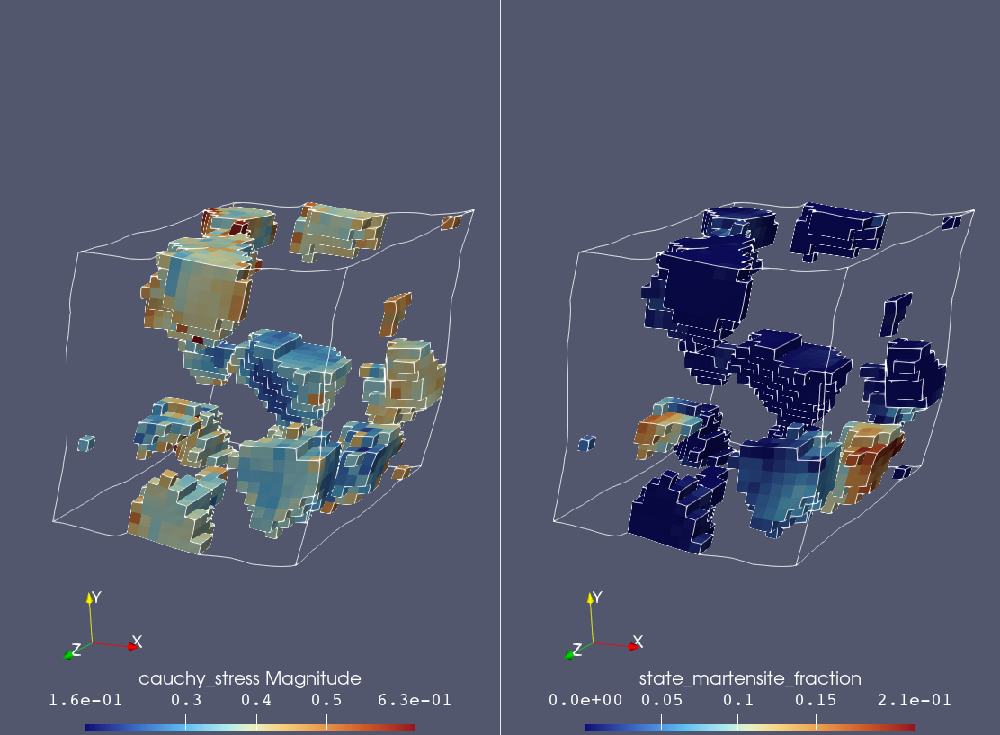
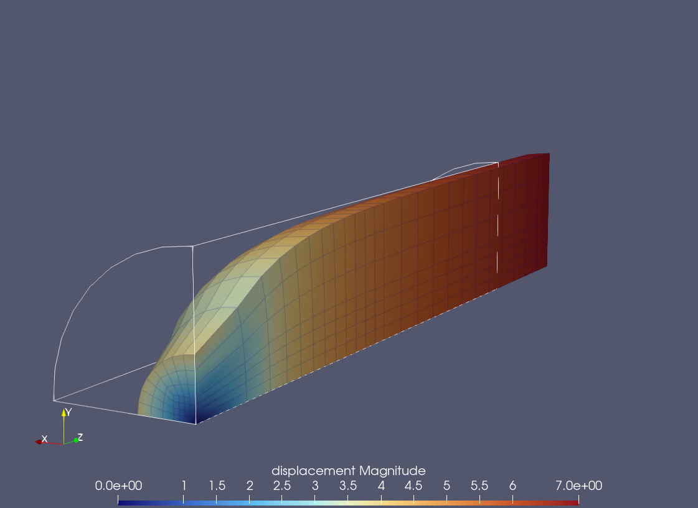
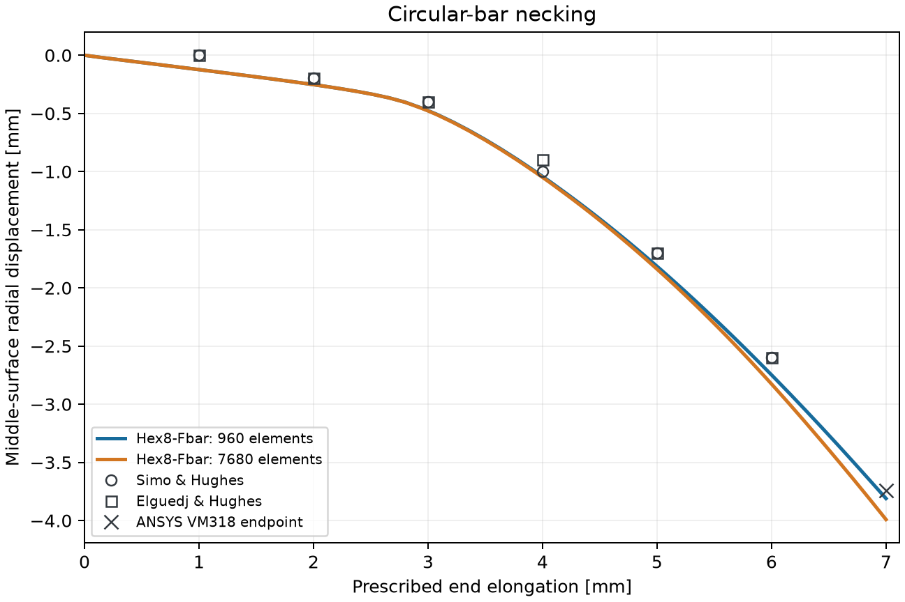
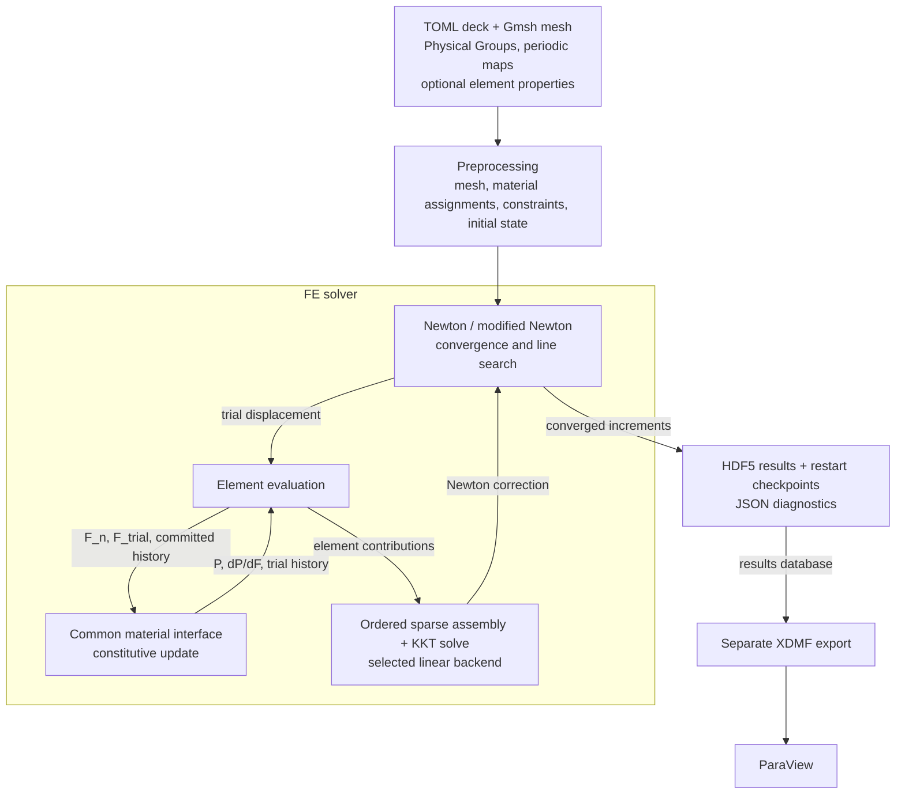

# A Material-Agnostic Finite Element Solver for Finite-Strain Solid Mechanics

[](LICENSE)
[](docs/ACCEPTANCE_RESULTS.md)

A three-dimensional finite-element solver built around an extensible material-point interface. It combines finite-strain element formulations, nonlinear equilibrium with general affine constraints, and periodic RVE simulations. Preprocessing, constitutive integration, global solution, and results visualization have distinct responsibilities.

[Results](#representative-results) · [Quickstart](#quickstart) · [User-defined materials](docs/MATERIALS.md) · [Formulation](docs/FORMULATION.tex) · [Running guide](docs/RUNNING.md)

## Representative results

<p align="center">

</p>

**Multiphase TRIP steel under simple shear.** A 24³-element periodic RVE at approximately 160 s of a 2000 s ramp to 20% shear: left, the displayed Cauchy-stress array magnitude; right, martensite fraction in the initially austenitic grains. Displacements are magnified for visualization and the domain outlines show the periodic deformation.

<table>
<tr>
<td width="50%"></td>
<td width="50%"></td>
</tr>
</table>

**Finite-strain J2 necking.** One eighth of an imperfect circular bar is modeled using Hex8-Fbar elements. Left: the 960-element mesh at 7 mm end displacement, colored by displacement magnitude, with deformation scale 1. Right: middle-surface radial displacement on the 960- and 7680-element meshes compared with published numerical reference values.

## Capabilities

- Full-integration Hex8 and serendipity Hex20 elements, plus centroidal Hex8-Fbar with its projection tangent.
- A common endpoint material interface using `F_n`, trial `F_np1`, first Piola–Kirchhoff stress, algorithmic `dP/dF`, and committed/trial history.
- User-defined material initialization and update routines in Python or any language accessible through a Python adapter; suitable Python kernels can be accelerated with Numba JIT compilation.
- Supplied compressible neo-Hookean and finite-strain J2/Voce models; an adapter for an external multiphase TRIP steel library.
- General affine displacement constraints and periodic boundary conditions through a sparse Lagrange-multiplier KKT system, without assuming tangent symmetry.
- Full and modified Newton, optional backtracking line search, user-defined time curves, adaptive stepping, rollback, and checkpoint restart.
- Parallel element calculations through Python's `multiprocessing`, with deterministic assembly; selectable SciPy/SuperLU and multithreaded SuperLU_MT direct backends.
- HDF5 results with selected material-state outputs and separate temporal XDMF export for ParaView.

PETSc LGMRES is being developed on the unmerged [iterative-solvers branch](https://github.com/syadegari/fe_solver/tree/feature/iterative-solvers); its validation status is described [below](#development-status).

## Quickstart

Use a Python environment with the project dependencies; the recorded development and verification environment uses Python 3.14. From the repository root:

```bash
python -m pip install -e .
python -m fe_solver solve examples/case_a_hex8.toml
python -m fe_solver postprocess examples/results/case_a_hex8/run.h5
```

This small neo-Hookean example uses the supplied mesh and the default SciPy backend. It writes `run.h5`, `run_log.json`, and restart checkpoints under `examples/results/case_a_hex8/`. Postprocessing adds `run.xdmf` and its HDF5 sidecar. In ParaView, open `run.xdmf` with **XDMF Reader T**, then apply **Warp By Vector** using `displacement`.

The analysis is configured by a TOML deck; referenced mesh, property, and output paths are relative to that deck. The [running guide](docs/RUNNING.md) covers installation details, mesh generators, other examples, output conventions, and restart.

Element calculations can run in parallel using Python's `multiprocessing`. Set the number of element-worker processes explicitly:

```bash
python -m fe_solver solve examples/case_a_hex8.toml --num-processes 2
```

### Optional SuperLU_MT backend

For a multithreaded direct solve, build the supplied bridge from the repository root. This requires CMake, a C compiler, Git, and network access to fetch SuperLU_MT:

```bash
cmake -S . -B build \
  -DCMAKE_BUILD_TYPE=Release \
  -Denable_internal_blaslib=ON \
  -DTHREAD_API=PTHREAD \
  -DPLAT=_PTHREAD
cmake --build build --parallel
ctest --test-dir build --output-on-failure
```

This produces `build/native/libsuperlu_mt_bridge.so`. Select it with an explicit solver thread count (replace `N` with the desired number):

```bash
python -m fe_solver solve examples/case_a_hex8.toml \
  --solver-backend superlu_mt --num-threads N
```

Element-process counts and global-solver thread counts are independent choices. See the [backend guide](docs/RUNNING.md#superlu_mt-backend) for configuration and the [native bridge notes](native/README.md) for standalone benchmarks.

## Architecture and extension

Preprocessing reads the mesh, Physical Groups, periodic maps, material assignments, and optional element properties. During solution, element kernels reconstruct deformation gradients and own the F-bar projection. Material routines return stress, tangent, and trial history through the common interface. The global solver assembles equilibrium and constraint equations, accepts converged states, and schedules output and checkpoints.



Postprocessing reads the completed HDF5 dataset without reevaluating the constitutive law.

To add a material, start with the [worked Python example](docs/MATERIALS.md). It covers registration, properties, state layout, failure handling, and selection from a TOML deck. Material `init` and `update` routines can be implemented in any language, provided a Python adapter exposes the common interface; see [compiled-library adapters](docs/EXTERNAL_MATERIALS.md). For Python implementations, suitable numerical kernels can benefit substantially from Numba JIT compilation, as used by the supplied J2 model.

| Responsibility | Main entry points |
| --- | --- |
| Preprocessing | [`prepare_analysis`](fe_solver/preprocess.py), mesh and property import |
| Material models | [`register_material_model`](fe_solver/materials.py), [request/response and state types](fe_solver/types.py) |
| Element evaluation | [`evaluate_element`](fe_solver/elements.py), kinematics and formulation-specific tangents |
| Sparse assembly | [`assemble_internal`](fe_solver/assembly.py), ordered reduction of element contributions |
| Affine and periodic constraints | [`build_constraints`](fe_solver/constraints.py) |
| Nonlinear solution | [`run_analysis`, `_newton_attempt`](fe_solver/solver.py) |
| Parallel execution and linear backends | [`ElementExecutor`](fe_solver/execution.py), [KKT solver interface](fe_solver/linear_solver.py) |
| Results and restart | [`HDF5ResultWriter`, `write_restart`, `load_restart`](fe_solver/io.py) |
| Visualization export | [`write_xdmf`](fe_solver/postprocess.py) |

The [formulation](docs/FORMULATION.tex) develops the equations and global algorithms; the [implementation specification](docs/IMPLEMENTATION_SPEC.md) defines the executable requirements.

## Verification and limitations

Install Matplotlib for the report-generation tests, then run:

```bash
python -m pip install matplotlib
python -m unittest discover -s tests -v
python -m verification.run_acceptance
```

The suite checks material and element derivatives, independent F-bar tangent formulations, affine constraints and periodic maps, state rollback, restart, and serial/process agreement. The default acceptance command runs eight neo-Hookean cases, including rotation and periodic cubes. J2 necking is selectable explicitly; repeating the TRIP examples requires the private material library. CTest runs the upstream SuperLU_MT tests; the Python suite checks the bridge against SciPy when it has been built. See the [running guide](docs/RUNNING.md).

| Evidence | Record |
| --- | --- |
| Element/material tangents and homogeneous acceptance cases | [Acceptance results](docs/ACCEPTANCE_RESULTS.md), [numerical tests](tests/test_numerics.py) |
| J2 necking, formulation differences, and mesh sensitivity | [Closed formulation study](verification/j2_formulation_study/README.md) |
| SciPy/SuperLU versus SuperLU_MT solution agreement | [Backend comparison](verification/superlu_mt_results/README.md) |
| Heterogeneous periodic TRIP examples and average-deformation checks | [Accepted RVE results](verification/multiphase_trip_results/README.md) |

This is a research solver with the element and loading scope listed above. Localized plastic-strain peaks and localization width can depend on mesh resolution. The TRIP source/library is private: archived outputs and plots are available, with large binary datasets stored through Git LFS, but repeating those solves requires the external model. Verification of that integration does not independently validate the constitutive physics.

The badges identify the license and recorded Python environment; they do not claim measured code coverage. Retrieve archived binary results with `git lfs pull`.

## Development status

SciPy/SuperLU and SuperLU_MT are integrated; modified Newton reuses its factorization within an increment. On the iterative-solvers branch, PETSc backend selection, the persistent MPI service, context reuse, true-residual checks, and failure logging are implemented. Frozen-system studies demonstrate remedies for restart-sensitive stagnation. Successful end-to-end FE comparisons and larger-system validation remain open in the [recorded integration study](https://github.com/syadegari/fe_solver/blob/feature/iterative-solvers/docs/ITERATIVE_SOLVER_INTEGRATION.md).

<details>
<summary>Completed milestones</summary>

**FE solver**

* [x] Implement full-integration Hex8, Hex20, and centroidal Hex8-Fbar elements.
* [x] Add neo-Hookean and finite-strain J2 materials with consistent tangents.
* [x] Implement adaptive time stepping and cutbacks.
* [x] Support periodic boundary conditions through Gmsh node maps.
* [x] Add HDF5 results/restart and temporal XDMF output for ParaView.
* [x] Parallelize element evaluation with persistent worker processes.
* [x] Verify J2 necking against published numerical results.
* [x] Record solver and assembly timings.
* [x] Add selectable SciPy/SuperLU and SuperLU_MT backends.
* [x] Integrate the external multiphase TRIP model and solve periodic multi-grain RVEs.

**Global linear solvers**

* [x] Capture KKT systems for standalone solver tests.
* [x] Compare SuperLU_MT results with SciPy/SuperLU.
* [x] Develop C and Python bridges with persistent SuperLU_MT factors.
* [x] Benchmark SuperLU_MT thread scaling on representative FE systems.
* [x] Integrate SuperLU_MT as a selectable backend with lazy loading.
* [x] Reuse factorizations within modified-Newton increments.

</details>

### Documentation

* [ ] Shorten the README and technical documentation; clarify derivations.

### Global linear solvers

* [ ] Verify PETSc MPI integration and compare small FE runs with SuperLU_MT.
* [ ] Validate PETSc tuning on larger frozen KKT systems.
* [ ] Reuse SuperLU_MT symbolic analysis when KKT sparsity is unchanged (`refact=YES`).
* [ ] Update the SuperLU_MT bridge to a selected upstream revision.
* [ ] Expose SuperLU_MT diagnostics and `ienv(7:9)` tuning through a separate TOML file.
* [ ] After PETSc validation, assess a shared-memory solver path without `mpiexec`.

### Nonlinear solver and elements

* [ ] [Separate logging, histories, and timing from the nonlinear algorithms](docs/SOLVER_CONTROL_FLOW_REFACTOR.md#observability).
* [ ] [Encapsulate adaptive stepping and event landing in a stateful controller](docs/SOLVER_CONTROL_FLOW_REFACTOR.md#time-step-control).
* [ ] [Extract line-search mechanics while keeping numerical decisions explicit](docs/SOLVER_CONTROL_FLOW_REFACTOR.md#line-search).
* [ ] Review Newton/modified-Newton convergence, especially near yielding.
* [ ] Review tangent and global-stiffness symmetry assumptions.
* [ ] Add patch tests for Hex8, Hex20, and Hex8-Fbar.
* [ ] Study cohesive-zone elements.
* [ ] Study contact elements.

Development uses an agent-assisted workflow: numerical design discussions, implementation, focused checks, and review are recorded through code, verification reports, and commits. The [development workflow](docs/DEVELOPMENT_WORKFLOW.md) explains attribution and verification practice.

## Citation

If you use this software in your work, please cite:

Sourena Yadegari (2026). *A Material-Agnostic Finite Element Solver for Finite-Strain Solid Mechanics* [Computer software]. [GitHub repository](https://github.com/syadegari/fe_solver).

```bibtex
@software{yadegari2026finite_strain_fe,
  author = {Yadegari, Sourena},
  title = {A Material-Agnostic Finite Element Solver for Finite-Strain Solid Mechanics},
  year = {2026},
  url = {https://github.com/syadegari/fe_solver}
}
```

For reproducibility, also report the release tag or commit hash used.
